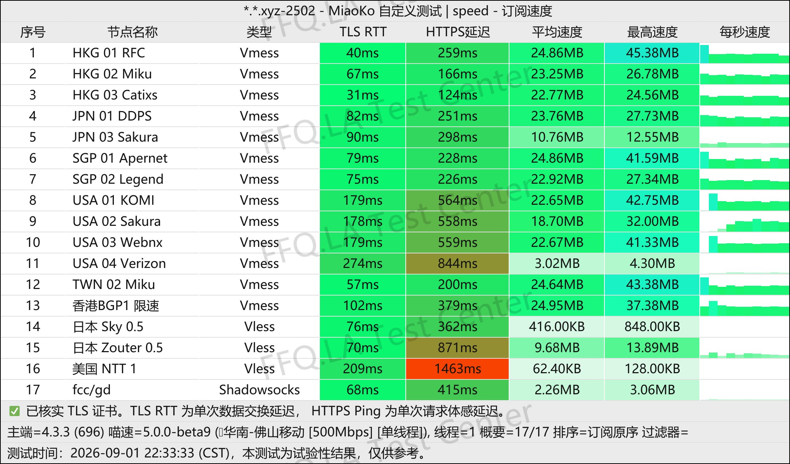
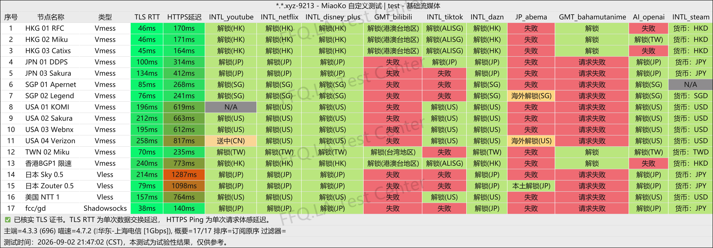
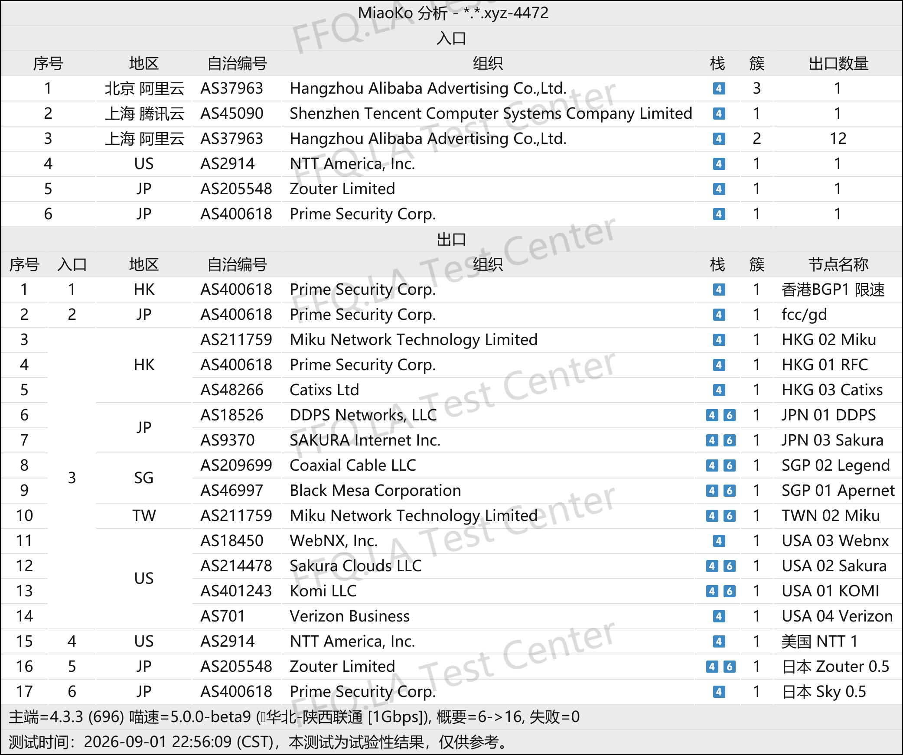

🇨🇳 [中文](README.md) | 🇺🇸 English | 🇷🇺 [Русский](README_RU.md) | 🇮🇷 [فارسی](README_FA.md)

# EasyCloud VPN Official Website (Updated November 3, 2026)

Official EasyCloud VPN Website<br>
Official URL: [dash.yiku.xyz](https://to.iix.im/easy01)<br>

## Invitation Code
```bash
LZj0frG8
```

## Promo Code
`Validity: 9.2 (Date as provided)`

```bash
10off
```

## Overview
EasyCloud VPN is a cost-effective network acceleration service provider that combines dedicated-line connections with high-quality direct routes. It supports popular transmission protocols, including Shadowsocks.

Its server network covers major regions across Asia-Pacific, North America, and other popular locations.

EasyCloud aims to provide a lightweight, low-latency, and highly available network access solution for everyday international web browsing, remote work, and streaming services.

## Advantages

* **Hybrid Dual-Route Architecture:** Combines the strong censorship resistance and stability of dedicated lines with the bandwidth and cost advantages of high-quality direct connections. This design supports both high-volume daily usage and reliable connectivity during critical periods.

* **Mainstream Protocol Compatibility:** Supports widely used proxy protocols and offers native compatibility with popular cross-platform clients, including Clash, Surge, and Shadowrocket.

* **Content Unblocking Support:** Optimized network routes for popular international streaming platforms such as YouTube and Netflix, as well as major AI tools, helping reduce connection latency and blocking issues.

* **Affordable Subscription Options:** Flexible pricing makes EasyCloud suitable as either a primary everyday VPN or a lightweight backup VPN. Its relatively low entry cost also makes testing and switching connections more affordable.

## Pricing Plans

| Plan | Price / Billing Cycle | Data Allowance | Route Multiplier | Streaming / GPT Unblocking | Device Limit | Purchase & Usage Notes |
| --- | --- | --- | --- | --- | --- | --- |
| **MINI** | ¥16.80 / Month | 100 GB / Month | Alibaba BGP (2× multiplier; switching via support ticket) | Supported (Netflix / Disney+ / GPT, etc.) | Unlimited devices (Personal use only) | Import subscription using a local network connection; Jiangsu / Quanzhou may have restrictions |
| **MICRO** | ¥28.00 / Month | 213 GB / Month | Alibaba BGP (2× multiplier; switching via support ticket) | Supported (Netflix / Disney+ / GPT, etc.) | Unlimited devices (Personal use only) | Import subscription using a local network connection; Jiangsu / Quanzhou may have restrictions |
| **BGP LARGE** | ¥60.00 / Month | 500 GB / Month | BGP (2×) / Free switching to optimized direct routes | Supported (Netflix / Disney+ / GPT, etc.) | Unlimited devices (Personal use only) | Import subscription using a local network connection; Jiangsu / Quanzhou may have restrictions |
| **Time Stop** | ¥76.00 / One-Time Payment | 300 GB (No expiration / No reset) | Alibaba BGP (2× multiplier; switching via support ticket) | Supported (Same features as monthly plans) | Unlimited devices (Personal use only) | Duplicate purchases not allowed; repurchase after data is exhausted; import subscription using a local network; Jiangsu / Quanzhou may have restrictions |

## 📊 Performance Tests & Analysis

#### 1. Evening Peak-Hour Speed Test
<br>

#### 2. Streaming Service Unblocking Report
<br>

#### 3. Entry and Exit Node Analysis
<br>
