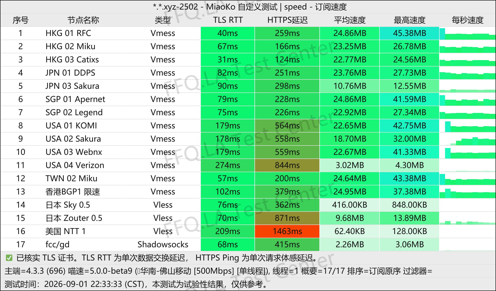
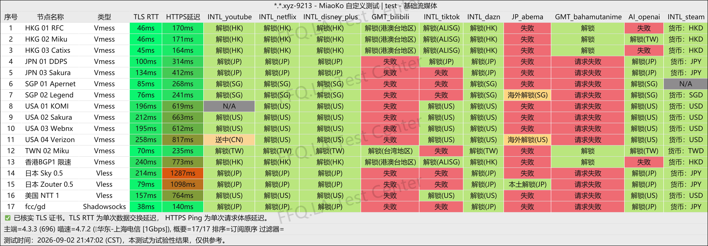
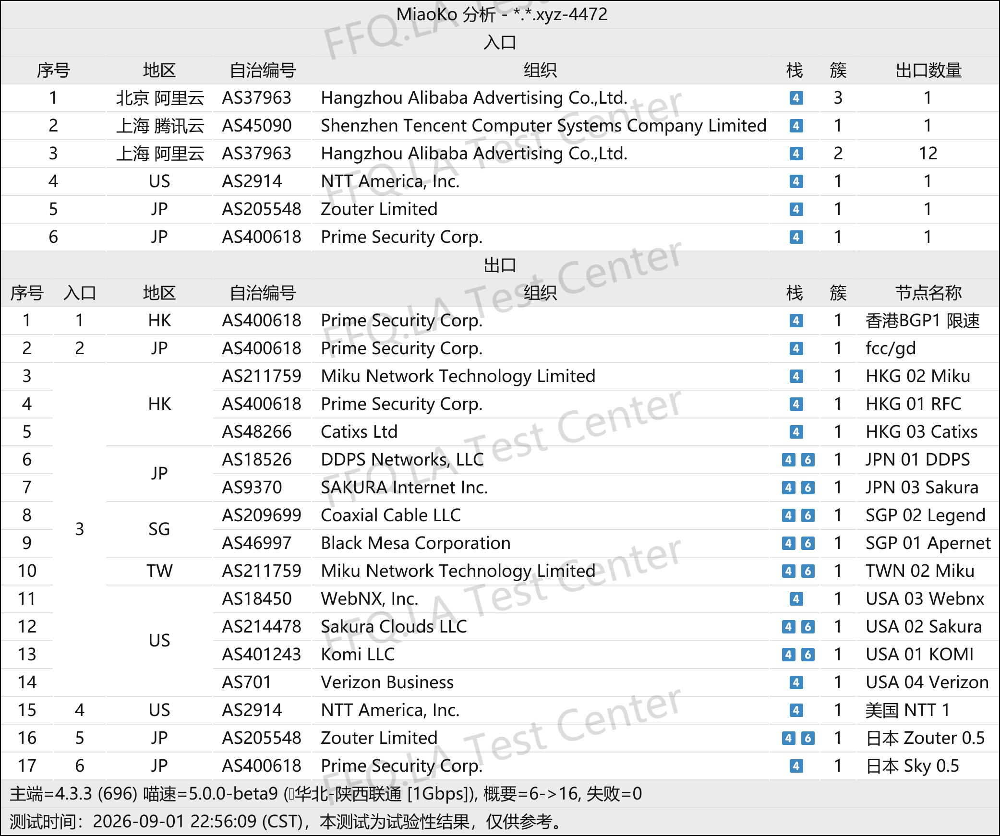

 🇨🇳 [中文](README.md) | 🇺🇸 [English](README_EN.md) | 🇷🇺 [Русский](README_RU.md) | 🇮🇷 فارسی

# وب‌سایت رسمی EasyCloud VPN(به‌روزرسانی 14 نوامبر 2026)
وب‌سایت رسمی EasyCloud VPN<br>
آدرس رسمی: [dash.yiku.xyz](https://to.iix.im/easy01)<br>

## کد دعوت
```bash
LZj0frG8
```

## کد تخفیف
`اعتبار: 9.2 (تاریخ مطابق اطلاعات ارائه‌شده)`

```bash
10off
```

## معرفی
EasyCloud VPN یک ارائه‌دهنده خدمات افزایش سرعت شبکه با قیمت مقرون‌به‌صرفه است که از معماری ترکیبی خطوط اختصاصی و مسیرهای مستقیم باکیفیت استفاده می‌کند. این سرویس از پروتکل‌های انتقال محبوب، از جمله Shadowsocks، پشتیبانی می‌کند.

شبکه سرورهای آن مناطق مهم آسیا و اقیانوسیه، آمریکای شمالی و سایر مکان‌های پرطرفدار را پوشش می‌دهد.

هدف EasyCloud ارائه راهکاری سبک، با تأخیر پایین و دسترس‌پذیری بالا برای مرور روزمره وب‌سایت‌های بین‌المللی، دورکاری و استفاده از سرویس‌های پخش آنلاین است.

## مزایا

* **معماری ترکیبی دو مسیر ارتباطی:** این ساختار پایداری بالا و مقاومت خطوط اختصاصی در برابر مسدودسازی را با مزایای پهنای باند و هزینه کمتر اتصالات مستقیم باکیفیت ترکیب می‌کند. در نتیجه، هم برای مصرف روزانه با حجم بالا و هم برای حفظ اتصال در زمان‌های حساس مناسب است.

* **سازگاری با پروتکل‌های رایج:** از پروتکل‌های پراستفاده پروکسی پشتیبانی می‌کند و با کلاینت‌های محبوب چندسکویی مانند Clash، Surge و Shadowrocket سازگاری بومی دارد.

* **پشتیبانی از رفع محدودیت محتوا:** مسیرهای شبکه برای دسترسی به پلتفرم‌های محبوب پخش آنلاین بین‌المللی مانند YouTube و Netflix و همچنین ابزارهای اصلی هوش مصنوعی بهینه‌سازی شده‌اند تا تأخیر اتصال و احتمال مسدودسازی کاهش یابد.

* **طرح‌های اشتراک مقرون‌به‌صرفه:** قیمت‌گذاری انعطاف‌پذیر باعث می‌شود EasyCloud هم برای استفاده به‌عنوان VPN اصلی روزانه و هم به‌عنوان VPN پشتیبان سبک مناسب باشد. هزینه اولیه پایین، آزمایش سرویس و تغییر مسیرهای اتصال را نیز اقتصادی‌تر می‌کند.

## طرح‌های اشتراک

| طرح | قیمت / دوره پرداخت | حجم ترافیک | ضریب محاسبه ترافیک | رفع محدودیت استریم / GPT | محدودیت دستگاه | توضیحات خرید و استفاده |
| --- | --- | --- | --- | --- | --- | --- |
| **MINI** | ¥16.80 / ماه | 100 GB / ماه | Alibaba BGP (ضریب ۲×؛ تغییر مسیر از طریق تیکت پشتیبانی) | پشتیبانی می‌شود (Netflix / Disney+ / GPT و غیره) | دستگاه‌های نامحدود (فقط استفاده شخصی) | وارد کردن اشتراک از طریق شبکه محلی؛ ممکن است در جیانگسو / چوانژو محدودیت وجود داشته باشد |
| **MICRO** | ¥28.00 / ماه | 213 GB / ماه | Alibaba BGP (ضریب ۲×؛ تغییر مسیر از طریق تیکت پشتیبانی) | پشتیبانی می‌شود (Netflix / Disney+ / GPT و غیره) | دستگاه‌های نامحدود (فقط استفاده شخصی) | وارد کردن اشتراک از طریق شبکه محلی؛ ممکن است در جیانگسو / چوانژو محدودیت وجود داشته باشد |
| **BGP LARGE** | ¥60.00 / ماه | 500 GB / ماه | BGP (ضریب ۲×) / امکان جابه‌جایی آزاد به مسیرهای مستقیم بهینه‌شده | پشتیبانی می‌شود (Netflix / Disney+ / GPT و غیره) | دستگاه‌های نامحدود (فقط استفاده شخصی) | وارد کردن اشتراک از طریق شبکه محلی؛ ممکن است در جیانگسو / چوانژو محدودیت وجود داشته باشد |
| **توقف زمان** | ¥76.00 / پرداخت یک‌باره | 300 GB (بدون انقضا / بدون بازنشانی) | Alibaba BGP (ضریب ۲×؛ تغییر مسیر از طریق تیکت پشتیبانی) | پشتیبانی می‌شود (مشابه طرح‌های ماهانه) | دستگاه‌های نامحدود (فقط استفاده شخصی) | خرید تکراری مجاز نیست؛ پس از اتمام حجم می‌توان دوباره خرید کرد؛ وارد کردن اشتراک از طریق شبکه محلی؛ احتمال محدودیت در جیانگسو / چوانژو |

## 📊 آزمایش عملکرد و تحلیل

#### 1. آزمایش سرعت در ساعات اوج مصرف شبانه
<br>

#### 2. گزارش رفع محدودیت سرویس‌های پخش آنلاین
<br>

#### 3. تحلیل سرورهای ورودی و خروجی
<br>
