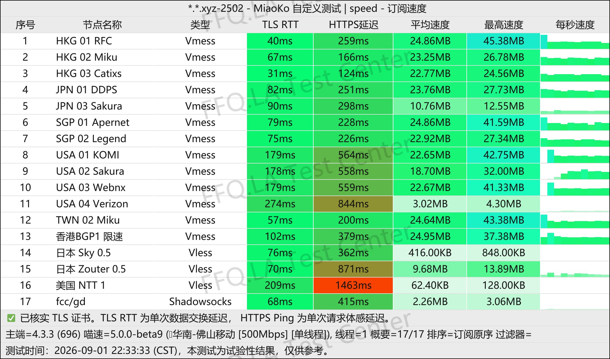
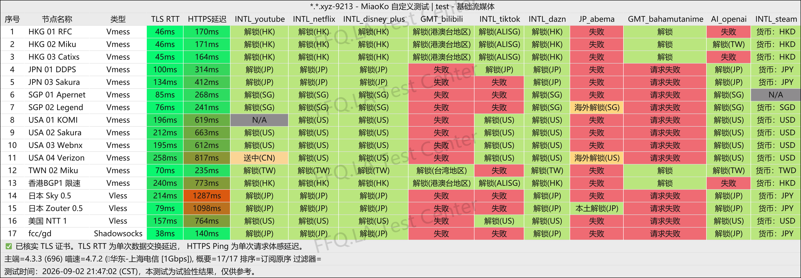
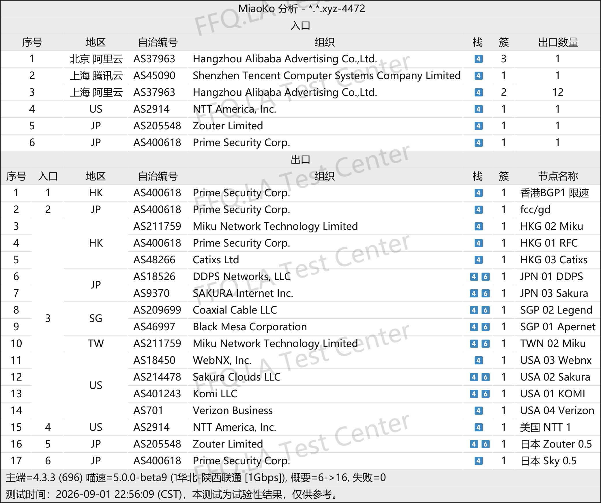

🇨🇳 [中文](README.md) | 🇺🇸 [English](README_EN.md) | 🇷🇺 Русский | 🇮🇷 [فارسی](README_FA.md)

# Официальный сайт EasyCloud VPN (обновлено 7 ноября 2026)

Официальный сайт EasyCloud VPN<br>
Официальный адрес: [dash.yiku.xyz](https://to.iix.im/easy01)<br>

## Пригласительный код
```bash
LZj0frG8
```

## Промокод
`Срок действия: 9.2 (дата указана в исходных данных)`

```bash
10off
```

## Обзор
EasyCloud VPN — провайдер услуг ускорения сетевых соединений с привлекательным соотношением цены и качества. Сервис использует гибридную архитектуру, объединяющую выделенные линии и высококачественные прямые маршруты, а также поддерживает популярные протоколы передачи данных, включая Shadowsocks.

Серверная сеть охватывает основные регионы Азиатско-Тихоокеанского региона, Северной Америки и другие популярные локации.

EasyCloud стремится предоставить лёгкое сетевое решение с низкой задержкой и высокой доступностью для повседневного просмотра зарубежных веб-сайтов, удалённой работы и использования стриминговых сервисов.

## Преимущества

* **Гибридная архитектура с двумя типами маршрутов:** Объединяет высокую устойчивость к блокировкам и стабильность выделенных линий с преимуществами прямых соединений по пропускной способности и стоимости. Такая архитектура подходит как для повседневного использования с большим объёмом трафика, так и для обеспечения надёжного подключения в критические периоды.

* **Совместимость с популярными протоколами:** Поддерживает распространённые прокси-протоколы и обеспечивает нативную совместимость с популярными кроссплатформенными клиентами, включая Clash, Surge и Shadowrocket.

* **Поддержка разблокировки контента:** Сетевые маршруты оптимизированы для популярных зарубежных стриминговых платформ, таких как YouTube и Netflix, а также основных AI-инструментов. Это помогает снизить задержку соединения и вероятность блокировок.

* **Доступные тарифные планы:** Гибкая ценовая политика делает EasyCloud подходящим как для основного повседневного использования, так и в качестве лёгкого резервного VPN. Низкая начальная стоимость также уменьшает расходы на тестирование и переключение маршрутов.

## Тарифные планы

| Тариф | Цена / Период оплаты | Трафик | Коэффициент учёта трафика | Разблокировка стриминга / GPT | Ограничения устройств | Условия покупки и использования |
| --- | --- | --- | --- | --- | --- | --- |
| **MINI** | ¥16.80 / Месяц | 100 ГБ / Месяц | Alibaba BGP (коэффициент 2×; переключение через заявку в поддержку) | Поддерживается (Netflix / Disney+ / GPT и другие) | Без ограничений (только личное использование) | Импорт подписки через локальную сеть; возможны ограничения в Цзянсу / Цюаньчжоу |
| **MICRO** | ¥28.00 / Месяц | 213 ГБ / Месяц | Alibaba BGP (коэффициент 2×; переключение через заявку в поддержку) | Поддерживается (Netflix / Disney+ / GPT и другие) | Без ограничений (только личное использование) | Импорт подписки через локальную сеть; возможны ограничения в Цзянсу / Цюаньчжоу |
| **BGP LARGE** | ¥60.00 / Месяц | 500 ГБ / Месяц | BGP (коэффициент 2×) / Свободное переключение на оптимизированные прямые маршруты | Поддерживается (Netflix / Disney+ / GPT и другие) | Без ограничений (только личное использование) | Импорт подписки через локальную сеть; возможны ограничения в Цзянсу / Цюаньчжоу |
| **Остановка времени** | ¥76.00 / Разовая оплата | 300 ГБ (без срока действия / без сброса) | Alibaba BGP (коэффициент 2×; переключение через заявку в поддержку) | Поддерживается (аналогично месячным тарифам) | Без ограничений (только личное использование) | Повторная покупка одновременно не допускается; после исчерпания трафика можно купить снова; импорт подписки через локальную сеть; возможны ограничения в Цзянсу / Цюаньчжоу |

## 📊 Тесты производительности и анализ

#### 1. Тест скорости в вечерние часы пик
<br>

#### 2. Отчёт о разблокировке стриминговых сервисов
<br>

#### 3. Анализ входных и выходных узлов
<br>
